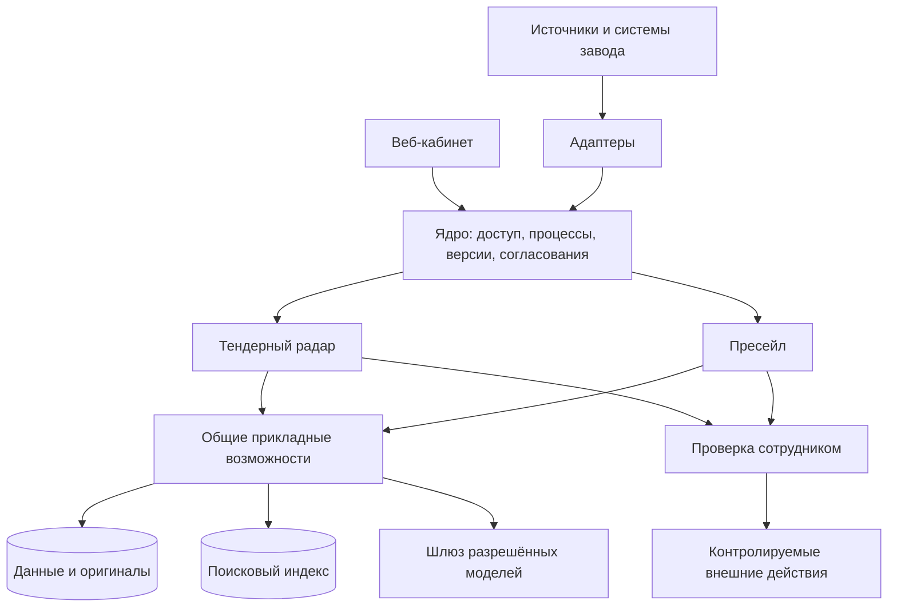

# Предварительная архитектура

Статус: предлагается. Версия 0.1, 6 октября 2026. Основание: [зафиксированные источники](../sources/README.md). Заказчик ещё не подтвердил открытые решения.

Дополнение того же дня: [12 полученных файлов](../discovery/customer-package-2026-10-06.md) конкретизируют внешние входы и форматы. [Карта источников](11-data-sources-and-intake.md) разделяет список закупок, документацию и внутренние данные. Изменения остаются предпроектными предложениями.

## Назначение и успех

Обрабатывать закупки и обращения клиента с общими средствами извлечения, проверки, расчёта и согласования. Результат считается пригодным к следующему действию, когда имеются проверенные факты, актуальные исходные данные и необходимое одобрение. Неопределённость должна приводить к проверке специалистом, а не к выдуманному значению.

## Уровни

1. Ядро: пользователи, полномочия, регистрация модулей, долговременные процессы, версии, согласования, аудит, модельный шлюз, внешние действия.
2. Прикладные возможности: документы, знания о крепеже, номенклатура, производственные ограничения, сопоставление, экономика, документы результата.
3. Бизнес-модули: радар и пресейл, каждый со своим жизненным циклом.
4. Адаптеры: источники закупок, 1С/CRM, файлы, почта, уведомления, доступ к моделям.
5. Хранилища: достоверные структурированные данные; оригиналы; производный поисковый индекс; история исполнения.

## Форма реализации

Предлагается модульный монолит бизнес-логики с отдельными фоновыми обработчиками для OCR, моделей и интеграций. Это позволяет изолировать ресурсы без отдельного сетевого сервиса на каждую функцию. Модули владеют своими данными и обращаются к публичным интерфейсам соседних компонентов.

Архитектура ядра не содержит ГОСТ, резьбу или экономику завода. Производственные знания располагаются в общем прикладном слое. Иначе следующие модули платформы получают лишнюю связанность.

## Три основных ограничения

- Модель извлекает сведения и помогает искать/формулировать. Обязательные ограничения и вычисления проверяются кодом.
- Согласование относится к конкретной редакции результата. Изменение входов может его аннулировать.
- Повтор фоновой задачи допустим, повтор бизнес-эффекта требует специальной защиты и сверки.

## Предварительный стек

Python/FastAPI, PostgreSQL, объектное хранилище, Qdrant, React/TypeScript. n8n указан в КП; Temporal рассматривается как альтернатива для долговременного исполнения. Одновременная установка двух оркестраторов не является требованием. Подробнее: [стек](08-stack-deployment.md).

## Что не объявлено согласованным

Состав первой поставки, конкретная модель, размещение/провайдер, полная интеграция ЕИС, SLA, правила производства и экономики, полномочия записи в 1С/CRM. Пресейл подготовлен архитектурно, его включение в первую поставку требует R01.

## Карта ближайших решений

Рамки и роли: R01, R10. Данные: R05, R11-R15. Ресурсы и обработка: R09, R16-R18. Расширения: R19-R22. [Реестр запросов](../discovery/requests.csv).

