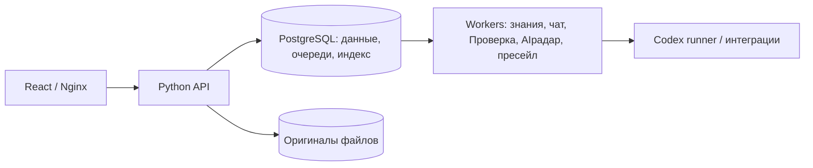

# Текущее устройство BERVEL

Редакция 11 ноября 2026. Рабочий корень — `C:/OSPanel/home/bervel.local`. Python-приложение объединяет общее ядро и предметные модули, PostgreSQL/pgvector, хранилище оригиналов и React-интерфейс. Тяжёлые задачи выполняют отдельные Python workers.

| Компонент | Ответственность |
|---|---|
| `core` | Оригиналы, права/область, документы, поиск, модельный клиент, инфраструктура и миграции |
| `chat` | Диалоги ассистента, типизированные действия и квитанции |
| `inspection` | Связь диалога с настоящим native Codex thread и событиями |
| `company_settings` | Общие каталог, склад, себестоимость, производство и снимки предприятия |
| `ai_tender_radar` | Профили источников, сбор, документы, сопоставление, оценка, вопросы и восстановление |
| `presales` | Комплекты клиентских файлов, анализ, статусы, цены и редакции предложения |
| `tickets` | Внутренние обращения и их история |

Общая сборка — `src/bervel/app_setup.py`, отдельная сборка радара/пресейла — соответствующие setup-модули. Ядро не импортирует предметные модули. Между ними используются публичные операции с явными зависимостями. [Карта Python](19-python-layout.md), [workers](22-independent-workers.md).

Файл имеет собственный неизменяемый ID. Метаданные/права находятся в PostgreSQL, байты — в хранилище; индекс производен. Редакции пресейла и снимки предприятия являются отдельными предметными сущностями. Модель извлекает/сопоставляет/объясняет; код проверяет источники, обязательные поля, количества и цены. Неизвестное не превращается в ноль или подтверждение.

По памяти установок на 11.11: API/worker пресейла — `bervel-presales:20261110-*`, схема `0029_presales_pipeline`, frontend — `bervel-ngrok-radar:20261110-frontend`. Исходники не устанавливаются автоматически; запущенные сервисы проверяются отдельно. [Команды Docker](../operations/docker-local.md).

Последний обход радара:377 готовых карточек и 23 предупреждения. [Адресный ремонт](../planning/2026-11-10-radar-document-repair.md) не завершён. Досылка в native Проверку и попап пресейла подготовлены отдельно, установка отложена.

n8n/Redis, учебный `document_review` и обычный `tender_radar` выведены. CSV остаётся инструментом чтения документов. История миграций от 0001 сохраняется; поздняя схема зависит от неё. Первичные источники, архивы/бэкапы и pending-материалы не удаляются по возрасту.

[Клиентские источники](../discovery/README.md), [открытые решения](09-open-decisions.md). Локальная реализация не подтверждает промышленный SLA, реальные возможности завода или разрешение автоматической отправки/подачи заявок.
