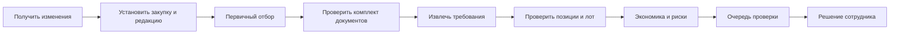

# Тендерный радар

Текущая реализация от 27.10.2026: [последовательный отбор по свободному остатку](23-radar-free-stock.md), [проверка на моковых данных](../quality/radar-free-stock-2026-10-27.md). Целевой контур ниже шире реализованного.

Статус: 22.10.2026 реализован ограниченный рабочий сценарий по автономному запросу владельца разработки: импорт XLSX/CSV, явный выбор RAG-файлов, первичный отбор и сохранённый отчёт с источниками. [Реализация](18-tender-radar.md), [проверки](../quality/tender-radar-report.md), [инструкция](../operations/tender-radar.md). Схема ниже описывает целевой контур; полнота функций, производство, экономика и клиентские решения по 1.1/R01 не объявлены подтверждёнными.

## Входы и выходы

Входы: поток закупок из подтверждённого источника, редакции документации, каталог и возможности, необходимые экономические данные.
Выходы: ранжированный список, карточка с позициями и доказательствами, экономическая оценка при достаточных данных, флаги риска и очередь проверки.

Получена историческая выгрузка «Контур Закупок»: 2 290 карточек со ссылками на агрегатор, ЕИС и 42 наименования площадок. Предварительное ТЗ прямо описывает ручное получение документации отдельно от экспорта. Конкретный API и автоматическое получение полного актуального комплекта ещё не подтверждены. Импорт списка и получение документов — отдельные этапы. [Схема источников и варианты интеграции](11-data-sources-and-intake.md).

## Процесс

Каждая стадия сохраняет результат по редакции. Недостаток данных переводит дело в ожидание/проверку, а не скрыто исключает закупку.

## Сбор

Курсор/окно обновления реализуется по возможностям подтверждённого API. Нужны дедупликация, повторная выборка перекрывающегося периода и контроль полноты. Номер закупки одного источника нельзя без проверки считать глобальным идентификатором. Изменения и отмены обрабатываются отдельно от новых записей.

Скачивание документов сохраняет manifest, контрольные суммы и ошибки отдельных файлов. Не скачанный обязательный документ означает неполный анализ.

В Excel читаются гиперссылки, а не только видимый текст; итоговая строка не становится закупкой. Дубли номера с разными URL/дедлайнами сохраняются до разрешения связи. Ссылки на поиск, договор, извещение и главную площадки различаются. Колонки исторического результата не заменяют техническую разметку и не участвуют в оценке отбора на более раннюю дату.

## Отбор и приоритет

Обязательные ограничения отделены от предпочтений. Каждое исключение содержит правило и причину. Пограничные случаи доступны сотруднику. Вес привлекательной цены не компенсирует обязательное техническое противоречие.

Приоритет учитывает только согласованные факторы. Дедлайн и часовой пояс сохраняются явно. Значение «90% отсева» из КП не является критерием качества.

## Позиции и лот

Результаты по позициям агрегируются с учётом условий участия в конкретном лоте. Нельзя считать лот подходящим только по проценту совпадений. Частичная поставка, альтернативы и закупка недостающего допускаются по правилам закупки и утверждённому процессу.

Разделены: техническое соответствие, производственная возможность, экономика, итоговое решение человека. Термин «спецзаказ» не заменяет эти измерения.

В приложенном примере один лот на 203 062 комплекта; частичная поставка запрещена. Комплект задан как один болт + одна гайка + одна шайба; два назначения поставки не являются двумя лотами. Требования к изготовителю, испытаниям, покрытиям и документам проверяются вместе с параметрами компонентов. Перечень чертежей не означает, что сами чертежи получены. Это условия конкретного образца, а не универсальное правило всех закупок.

## Изменения после анализа

Новая редакция документации -> анализ влияния -> новая редакция заключения -> аннулирование затронутого согласования -> уведомление ответственного. Отмена закупки прекращает новые действия; история остаётся. Поздний ответ от старого запуска не заменяет актуальную редакцию.

## Условные расширения

- Дооснащение: правила и заключение технолога.
- Окупаемость: отдельный сценарий экономиста, а не вывод по одному тендеру.
- Чертежи: эксперимент и оговорённая ручная проверка.
- Пакет участия: R19 определяет чек-лист, подбор файлов или заполнение форм.
- Подача на площадку и электронная подпись требуют отдельного решения.

## Приёмка

Полнота сбора; recall подходящих закупок; precision списка; верность обязательных параметров; опасные ложные допуски; причины ручной проверки; обновление редакций; восстановление после сбоя. Пороговые числа утверждаются по 6.5, здесь не назначаются.

Связанные запросы: R01-R05, R11-R19. Функции RADAR-*.

