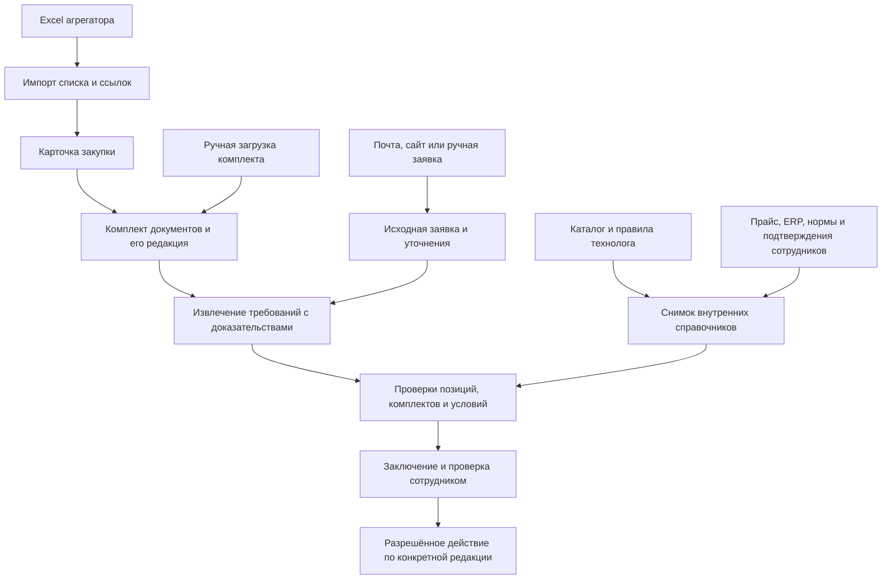

# Источники данных и первый контур обработки

Дата: 6 октября 2026. Статус: уточнение предпроектной архитектуры по полученному пакету; варианты реализации предлагаются. Основание — [разбор 12 файлов](../discovery/customer-package-2026-10-06.md) и [реестр источников](../sources/customer-package-2026-10-06.manifest.json). Ссылки F01–F12 относятся к этому реестру.

## Что стало известно

Заказчик описывает два связанных процесса: анализ закупок относительно возможностей завода и обработку входящих заявок относительно его номенклатуры. Предварительные пожелания также включают освоение изделий, оборудование и инвестиционную оценку; далее в таблице есть отдельные маркетинговые и управленческие задачи. Состав первой поставки по-прежнему определяет R01.

Основной уточнённый источник тендерного списка — выгрузка «Контур Закупок» либо другого согласованного сервиса. В F01, `Лист1!D2`, заказчик прямо разделяет выгрузку таблицы и ручное скачивание технических документов по ссылке на закупку. F02 содержит именно такой исторический список. Автоматический канал получения полного комплекта ещё нужно испытать.

Для заявок названы сайт и почта, а для внутренних данных — технология компании, CRM и ERP (F01, D3, D15–D16). Конкретные продукты, объекты, API и права не указаны. Прежнее упоминание 1С в опроснике остаётся кандидатом интеграции, а не доказательством того, что все необходимые сведения уже есть в одной базе.

Сайт БЕРВЕЛ использован в понравившемся заказчику примере (F01, F15). Он может давать кандидатов каталога и описания продукции. Доступность на складе, выполнимость партии, цену, срок и допустимость замены подтверждают отдельные внутренние источники или сотрудники.

## Откуда приходит каждый вид сведений

| Данные | Что реально есть | Предлагаемый канал | Что ещё требуется |
|---|---|---|---|
| Список закупок | F02: карточки, идентификаторы, даты, НМЦ, площадки и ссылки | Сначала импорт Excel; затем согласованный экспорт/API агрегатора | Фильтры, частота, доступ, тариф, стабильные ID, изменения и отмены |
| Документация конкретной закупки | F03–F08: памятка, ценовой анализ, техническая часть, общие/специальные условия, проект договора | Ручной комплект; затем адаптер получения файлов с конкретной карточки | Доступность полного комплекта, авторизация, архивы, редакции, отсутствующие приложения |
| Входящая потребность клиента | F11 — исходный скан; в F09/F10 исходные поля уже включены в чужие отчёты | Ручная загрузка; почта/сайт после выбора канала | Оригиналы двух остальных заявок, переписка, метаданные обращения, правила дублей |
| Кандидаты изделий | Ссылки и выводы в F09/F10/F12; указан публичный сайт | Версионированный снимок согласованного каталога, допустим первоначальный импорт таблицы | Артикулы, варианты размеров/покрытий/классов, владелец и полнота каталога |
| Допустимость стандартов и замен | Требования конкретной закупки, чужие предложения аналогов | Утверждённая таблица технолога с условиями применения | Правила эквивалентности и согласование альтернатив по конкретному заказу |
| Возможности производства | В F01 названы внутренние данные технологии; выгрузки нет | Утверждённая таблица возможностей; позже интеграция с ERP при наличии нужных объектов | Сочетания параметров, комплектность, ограничения партии, оснастка, испытания и ответственный |
| Остатки и подтверждённый срок | Не предоставлены | ERP/1С по чтению либо ручное подтверждение | Источник, возраст данных, резервы, загрузка и метод расчёта срока |
| Коммерческая цена | Внешняя НМЦ и чужие каталожные подборы не дают цену БЕРВЕЛ | Действующий прайс/CRM/ERP и коммерческие правила | Вид цены, налоги, скидки, валюта, срок действия и утверждение |
| Себестоимость и инвестиционная оценка | Запрошены в F01, внутренних расчётных данных нет | Методика экономиста + нормы/затраты + утверждённые сценарии | Формулы, факторы затрат, логистика, обеспечение, загрузка и оборудование, если включено |
| Документы участника | F03/F06/F07 показывают требования и формы | Реестр действующих документов БЕРВЕЛ, если выбран R19 | Владельцы, сроки действия, поля форм, режим доступа; участие и подпись отдельно |
| Ожидаемый вид ответа | F09/F10/F12: таблица позиций, ограничения и рекомендации | Единый структурированный результат и его представление | Экспертные эталоны, разрешённые утверждения, критерии приёмки |

## Поток данных

Список закупок, документация и внутренние справочники имеют отдельные жизненные циклы. Успешный импорт строки Excel не означает получение документов. Получение документов не означает наличие данных завода. Отчёт сторонней системы хранится с ролью `third_party_assessment`; его выводы не записываются автоматически в справочник возможностей.

## Уточнения общего слоя

Существующее разделение на ядро, общие предметные функции и два бизнес-модуля сохраняет смысл. По этому пакету не возникает доказанной необходимости выделять новый сервис на каждый вид документа или использовать отдельного агента на каждую задачу. Сначала нужно уточнить входные данные и решения, которые система должна проверять.

Предлагаются следующие дополнения концептуальной модели и контрактов:

- `ImportBatch / SourceRecord`: checksum файла, лист, строка, версия схемы, ошибки импорта и происхождение каждого поля. Итоговые строки и групповые заголовки не становятся закупками.
- Карточка агрегатора и закупка во внешней системе: отдельные `origin_system`, `external_id`, ссылки на ЕИС и площадку, связь между ними. Число в строке нельзя без проверки использовать как глобальный ключ всех систем.
- `PackageManifest`: роль каждого документа, checksum, статус получения, источник и связь с редакцией закупки. Отдельно отмечаются приложения, на которые документ ссылается, но которых нет в комплекте.
- `RequirementLine`: исходная единица, число комплектов/штук, явная комплектность, материал, покрытие, стандарты и редакции, прочность/твёрдость, испытания, упаковка и подтверждающие документы. Набор обязательных полей зависит от семейства изделия.
- Требования на уровнях изделия, комплектующих, лота и договора. Совпадение одного болта не подтверждает соответствие всего болтокомплекта или возможность участия в лоте.
- `MatchAssessment`: кандидат каталога, техническое соответствие, возможность производства, доступность/срок, коммерческие условия и допустимость альтернативы проверяются раздельно. Одна зелёная отметка не заменяет эти результаты.
- Коммерческие и процедурные условия: календарные/рабочие дни, событие начала срока, аванс, приёмка, обеспечение, гарантия, сертификаты и критерии оценки с привязкой к пункту документа.
- Числовые итоги рассчитываются из проверенных строк. Масса, количество штук и количество комплектов сохраняются раздельно; модель не придумывает коэффициент их пересчёта.

Это предложения к существующим [модели данных](05-data-model.md) и [контрактам](06-contracts.md), а не физическая схема БД или API подключённой 1С.

## Чтение реальных форматов

В F02 значимые URL хранятся в гиперссылках ячеек. Чтение только видимого текста теряет путь к документам. Импорт должен сохранять исходный номер как строку, исходный адрес ссылки и его роль. НМЦ и цена договора — разные поля; сумма по столбцу не является отдельной закупкой.

F11 требует OCR или визуального чтения: текстовый слой не даёт надёжного извлечения заявки. F09/F10 имеют таблицы подбора; F12 — изображение результата. Их нельзя смешивать с первичными заявками при формировании обучающего или контрольного набора.

PDF технического задания содержит широкие таблицы и признаки нарушенного порядка текстового слоя. Способ чтения выбирается по странице: структурированный текст, восстановление таблицы, OCR или ручная проверка. Наличие текстового слоя само по себе не доказывает корректность извлечения.

DOCX читается с сохранением таблиц, заголовков и пунктов. Бланк с незаполненными полями — шаблон, а не факт о поставщике или подписанном договоре. Раздел из типового документа становится применимым только после проверки специальной части и вида процедуры.

## Варианты получения тендерной документации

| Вариант | Польза | Ограничение |
|---|---|---|
| Импорт Excel и ручная загрузка комплекта | Доступен на полученных образцах, позволяет проверить предметный слой | Сотрудник продолжает получать файлы; автоматизация сбора не доказана |
| Агрегатор для списка + получение комплекта по конкретным ссылкам | Соответствует описанному заказчиком процессу, можно наращивать по выбранным площадкам | Нужен эксперимент на разрешённом доступе: ссылки, авторизация, архивы, изменения и полнота |
| Прямой сбор из ЕИС и всех площадок | Возможный отдельный интеграционный путь | Условия доступа и покрытие неоднородны; пакет не доказывает готовый универсальный API |

Рекомендуется первый вариант для предметного вертикального среза, затем второй для согласованного потока. Третий рассматривается только при подтверждённой необходимости и доступе. Ни один из вариантов не закрывает R11 фактом наличия ссылки в Excel.

## Первый проверяемый результат

Для тендерного контура использовать строку 125 F02 и F03–F08: восстановить связь карточки с комплектом, извлечь технические и коммерческие условия, показать отсутствующие сведения и передать заключение сотруднику. До получения подтверждённых справочников результатом будет структурированная потребность и перечень проверок, а не положительный допуск производства.

Для общего слоя распознавания отдельно использовать F11. Сверить девять строк с исходным сканом, проверить числа и воспроизвести таблицу фактов. F12 использовать для разбора ошибок представления и недоказанных выводов. Это ещё не означает включение интеграций пресейла в поставку.

Эксперимент считается полезным, если у каждого существенного поля есть источник и статус, неполнота видна, числовые итоги воспроизводимы, а сравнение использует конкретный снимок каталога/правил. Продуктовые тесты и проверка модели на этом пакете пока не проведены.

## Решения, которые остаются за заказчиком

1. Состав этапа: радар, обработка заявок, инвестиционные сценарии, пакет участия и остальные группы пожеланий.
2. Какой сервис формирует рабочий список закупок и как получать актуальные документы без ручной загрузки.
3. Авторитетный каталог, производственные правила, допустимость альтернатив и владельцы конфликтов.
4. Где подтверждаются цена, себестоимость, остатки и срок; какие сведения действительно доступны из ERP/1С/CRM.
5. Кто утверждает предметные эталоны и какие утверждения разрешены до проверки технологом/экономистом.

Адресные уточнения без повторного запроса уже полученных файлов — в [покрытии R01–R22](../discovery/customer-package-request-coverage.csv).
