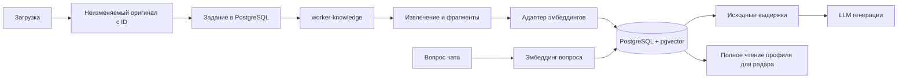

# Общая база знаний: загрузка, индекс, поиск

Файловые ссылки обновлены28.10.2026 для [модели одного ID](25-independent-files.md). Её установка в основной runtime ещё не подтверждена; ниже описан контракт подготовленной реализации. Параметры embedding-моделей этим переходом не менялись.

Состояние реализации — 27 октября 2026. Установлены [отдельные workers](22-independent-workers.md). Основной корень: `C:/OSPanel/home/bervel.local`.

## Поток данных

1. `ArtifactService` сохраняет неизменённые байты оригинала в существующее объектное хранилище. Метаданные и задание `knowledge_jobs` регистрируются одной транзакцией PostgreSQL.
2. `worker-knowledge` выполняет индексацию порциями; `worker-chat` и `worker-radar` исполняются независимо в отдельных контейнерах из того же образа. Брокер очередей не добавлялся.
3. `DocumentReader` извлекает текст. CSV/XLSX сохраняют заголовки, строки и названия листов; PDF — страницы; TXT/DOCX — абзацы. Для изображений сохраняется существующее OCR и возможность приложить оригинал к мультимодальному запросу. Неизвестный формат получает явное состояние `unsupported`.
4. `chunking.py` делит длинные блоки преимущественно по границам абзацев/предложений. Обычная граница — около 1500 символов; контекст заголовка таблицы повторяется у частей длинной строки. Длинные ячейки XLSX сохраняют название столбца и идентичность строки. Окончательный размер проверяет токенизатор выбранной модели. Текст не обрезается ради лимита модели.
5. `KnowledgeService` сохраняет подготовленные фрагменты и их локаторы один раз. Адаптер эмбеддингов возвращает настоящие числовые векторы; PostgreSQL с расширением pgvector хранит их вместе с моделью и ID исходного файла.
6. Чат кодирует вопрос той же embedding-моделью. Поиск объединяет близость векторов и лексическое ранжирование. В LLM передаются исходные текстовые выдержки, имя и ID файла, страницы/строки. Числовые векторы в промпт не попадают.

## Границы компонентов

- `core/knowledge.py` — сценарий индексации и контракт embedding-клиента; не знает HTTP или SQL.
- `core/chunking.py` — детерминированное разбиение и границы порций.
- `core/infrastructure/embeddings.py` — OpenAI HTTP, токенизатор и ограничение нагрузки.
- `core/infrastructure/local_embeddings.py` — разрешённая пользователем альтернатива на CPU.
- `core/infrastructure/knowledge.py` — задания, сохранение векторов, точный поиск pgvector и контроль области данных.
- `core/document_memory.py` — общий контекст для модулей; проверяет доступность и целостность оригиналов, ограничивает контекст чата 12 фрагментами/16000 символами.
- `app_setup.py` — выбирает реализации и передаёт их чату, радару и worker.

Радар использует тот же подготовленный индекс, но выбранный профиль читает **полностью**, с проверкой покрытия и пределом 96 КиБ. Семантический top-k не заменяет полный проход по тендерам и не меняет правила отбора/сроков. Подбор тендеров по смыслу и извлечение справочного контекста — разные сценарии.

## Модель и ограничение нагрузки

В текущем окружении: OpenAI `text-embedding-3-small`, 1536 измерений, `cl100k_base`. Ключ — только `BERVEL_EMBEDDING_API_KEY` в окружении сервера. Настройка `BERVEL_EMBEDDING_PROVIDER=openai` отделена от провайдера генерации ответов.

Проверенный 27.10 ответ API: HTTP 200; квота проекта 40000 токенов/минуту. Суммарный бюджет приложения ограничен 32000 токенов за скользящую минуту, порцией до 8000 токенов/64 фрагментов и интервалом не менее 5 секунд между запросами. После разделения выделено 24000 токенов/минуту для индексации и 8000 для чата (суммарно 32000). При горизонтальном масштабировании потребуется пересмотр бюджетов или общий лимитер; текущая реализация не заявляет такую возможность.

Одинаковые embedding-входы в одном `data_scope` и пространстве модели переиспользуют сохранённый вектор. Имя загруженного файла не включено в embedding-вход, но остаётся в метаданных, лексическом поиске и ссылках на источники. Поиск не смешивает разные модели, области доступа или источники.

Альтернатива `local`: закреплённая редакция `intfloat/multilingual-e5-small@614241f622f5:mean:384`, ONNX CPU, 384 измерения, предел 512 токенов и префиксы `query:`/`passage:`. Это отдельное пространство векторов. При переключении провайдера требуется явная переиндексация; нулями векторы не дополняются.

## Состояния и восстановление

Страница «Файлы» показывает `pending`, `running`, `ready`, `partial`, `unsupported` или `failed` и число готовых фрагментов. При HTTP 429, ошибке доступа, таймауте или прерывании worker успешные порции сохраняются. Автоматического повторения нет. «Продолжить подготовку» обрабатывает отсутствующие векторы после устранения причины. Частично извлечённый файл явно помечен `partial`; это не полное покрытие документа.

HTTP-контракты: `GET /api/v0.1/artifacts/{id}/knowledge`; `POST .../knowledge/resume` с `{}`. Первому нужны права чтения, второму — записи, оба проверяют область данных и ID файла.

## Хранение и ограничения

Историческая миграция `0008_shared_knowledge` добавила `knowledge_jobs`, `knowledge_chunks` и логическое удаление файлов из каталога. Миграция0013 переносит индексы на ID файла, сохраняя готовые векторы без повторного запроса к модели. Полное удаление очищает данные конкретного файла; исторические чаты/отчёты и миграции сохраняются. pgvector установлен в существующий PostgreSQL 17.9 без пересоздания его volume; расширение 0.8.7.

Поиск пока точный, без HNSW и отдельного векторного сервера: текущий объём — несколько тысяч фрагментов. Расширять индекс следует по измерениям задержки. Скорость обработки 100000 тендеров за два часа этим изменением не доказана.

Пределы извлечения сохраняются явными: до 5 млн символов текста, PDF до 100 страниц (OCR до 10 страниц с ограничением времени). Формат без декодера остаётся доступен для скачивания, но не получает выдуманный текст/вектор.

Для каждого нового формата нужен корректный декодер, а не отдельная система поиска. Сохранение оригинала, индексация, права и потребление контекста остаются общими.
