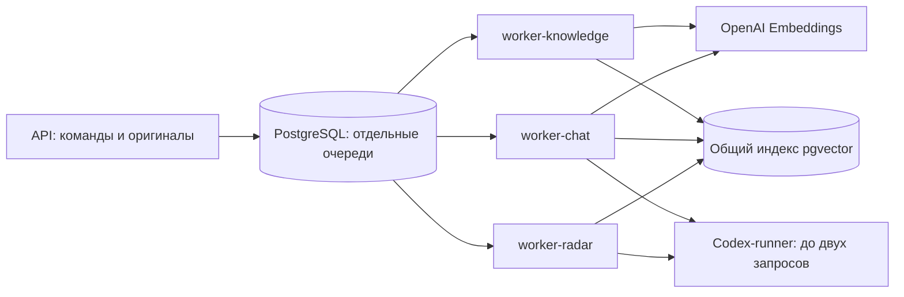

# Независимое исполнение фоновых сценариев

Установлено и проверено 27.10.2026. Пользователь выбрал подготовку во время индексации и установку после её окончания; этот порядок соблюдён. Все 3668 рабочих фрагментов готовы, старый комбинированный контейнер удалён.

## Что меняется

Один образ Python-приложения запускается в трёх отдельных контейнерах. Обязательный параметр CLI выбирает единственный обработчик процесса:

| Контейнер | Команда | Ответственность |
|---|---|---|
| worker-knowledge | `python -m bervel worker --module knowledge` | Извлечение, разбиение, эмбеддинги |
| worker-chat | `python -m bervel worker --module chat` | Сообщения чата |
| worker-radar | `python -m bervel worker --module radar` | Подбор тендеров |

Сам HTTP-запрос загрузки и сохранение оригинала остаются в API. Это короткая операция; её результат ставит длительную подготовку в PostgreSQL. Knowledge-worker не занимается HTTP-загрузками.

Каждый worker вызывает только свой `run_once`. Ожидание embedding-квоты или долгий запуск радара не занимает процесс чата. Сбой/перезапуск одного контейнера не перезапускает соседние. SIGTERM завершает текущую порцию, сохраняет результат и останавливает цикл до следующего задания. Комбинированный режим CLI удалён: роль обязательна.

Для индексации порция ограничена; для чата единицей является один ответ. У радара по прежнему выбору пользователя единица работы — полный длинный запуск без промежуточного сохранения. Мягкая остановка ждёт завершения обработчика в пределах Docker grace period; после принудительного завершения долгого радара его незавершённый результат не обещается сохранить. Остальные workers продолжают исполняться независимо, автоматического повтора генерации нет.

## Общие ресурсы

Это разделение исполнения внутри модульного приложения. Код, PostgreSQL, оригиналы, индекс и настройки модели общие. Новых БД, брокеров очередей или копий бизнес-правил нет. Доступ к БД не превращается в отдельную security-границу: процессы по-прежнему используют согласованные общие права приложения.

Knowledge-worker подключён только к сети БД. Chat/radar также подключены к существующему Codex-runner. Все используют существующие контракты и таблицы своих очередей, включая защиту PostgreSQL от повторного захвата задания.

Ранее runner отвергал второй запрос с `MODEL_BUSY`. Подготовленная версия разрешает два параллельных SDK-thread с раздельными входами/выходами, третий получает явную ошибку занятости. Освобождение слота происходит и после ошибки. Настройки провайдера и внешние MOX-файлы сохраняются, автоматических повторов нет.

Для наблюдаемой embedding-квоты 40000 токенов/минуту knowledge-worker получает бюджет 24000, chat-worker — 8000. Суммарно 32000; заголовок провайдера не повышает выделенный бюджет роли. Радар использует полное чтение профиля без embedding-вызова. При изменении квоты или числа реплик бюджеты нужно пересмотреть; произвольное горизонтальное масштабирование этим решением не обеспечено.

## Проверка и переключение

Проверены роли/CLI, корректное завершение порции, отдельные бюджеты, два одновременных запроса и ограничение третьего, освобождение слота после ошибки. Настоящие SDK/CLI-процессы с общим `CODEX_HOME` одновременно дошли до локального тестового Responses-сервера; каждый получил только свой ответ. Это проверка протокола/параллелизма, а не оценка качества внешней LLM.

Основной/dev/E2E Compose и `docker.ps1` обновлены. Проверенные образы `bervel-api:workers-check` и `bervel-codex:workers-check` установлены под рабочими тегами `:local`. Настройки и read-only MOX-монтирования сохранены.

Применённый порядок переключения:

1. Проверить embedding API, явно продолжить недостающие фрагменты и дождаться окончания индексации.
2. Завершить сравнение поиска по полному корпусу и два контрольных чата.
3. Убедиться, что активной генерации нет; мягко остановить прежний worker.
4. Установить проверенные API/runner и три role-worker с прежними volumes и теми же read-only MOX-монтированиями.
5. Проверить реальные команды/образы, готовность API/модели и независимость процессов. Удалить остановленный прежний контейнер worker без удаления volumes.

Фактическая проверка: при остановленном radar-worker чат и knowledge-worker продолжили работу, одновременно ответили на вопрос и подготовили новый файл. Пересечение состояний зафиксировано в `live-workers.json`. Radar-worker снова запущен; временный тестовый оригинал сохранён в `.dev` и убран из активного каталога. Полная проверка: [отчёт](../quality/shared-knowledge-evaluation-2026-10-27.md). План: [разделение обработчиков](../planning/2026-10-27-worker-isolation-plan.md).
