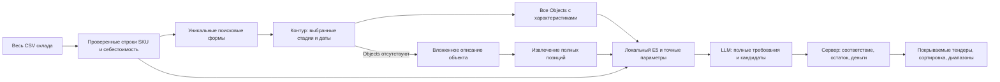

# Радар 1.7: таблица склада и проверка объектов закупки

Радар читает весь исходный складской CSV через StockImporter и EconomicsImporter. Общий RAG-индекс файла не нужен: файл с ролью stock доступен радару сразу после сохранения. Обработчик базы знаний не берёт новые stock CSV для автоматической общей индексации и не выдаёт их за готовые векторные индексы. Прежние готовые индексы сохраняются; смена роли на general позволяет обычную индексацию. Чат и проверка сохраняют свой прежний провайдер поиска.

Вызовы новой формы передают pipeline_version=1.7. Поисковые слова вычисляет сервер из product_group/product_subtype и подтверждённого семейства товара. Для текущего каталога это болтокомплекты, болты, гайки, шайбы и холоднотянутый прокат. Слова не повторяются; сохраняются отдельные полные формы единственного и множественного числа. Реальная проверка Контур API показала потерю результатов у основ слов. Text[] проверен как OR; общий лимит уникальных карточек распределяется между группами, ID дедуплицируются. Эффективный запрос и фактические счётчики сохраняются в снимке. Числа пересекающихся поисков не складываются в вымышленное количество уникальных закупок.

Все API Objects переносятся без модельного извлечения количества и цены. Сохраняются Name, Values, Okei, FillingInstruction и стабильный индекс каждого вхождения. Повторный provider object_id не объединяет разные потребности. Название закупки не заменяет состав. При отсутствии Objects читается вложенное описание; отсутствие обоих источников явно обозначается, модели не отправляют сообщения об ограничениях вместо состава.

LocalStockSearch индексирует все SKU. Общие языковые описания группируются для E5; размеры, стандарты, покрытия и все непустые исходные факты остаются в точном поиске и в доказательствах для модели. В закреплённом E5 различаются префиксы passage и query: деление на порции учитывает фактический префикс, сохраняет все символы и проверяет реальный бюджет токенизатора. Порог косинусной близости не доказывает отсутствие изделия. Локальный поиск только предлагает кандидатов.

Модель подтверждает изделие по всем раскрытым требованиям. Ответ ограничен ID позиции, допустимым SKU, булевым соответствием и причиной. Сервер проверяет состав ответа и запрещает подмену SKU, позиции или количества. Отсутствующее складское подтверждение предъявленного параметра, противоречивые размерные факты и несовместимые изделия не дают положительного покрытия. Поля *_options описывают возможности и не доказывают конкретный параметр. Явно перечисленные ГОСТ и дополнительный СТО — самостоятельные декларации, без автоматического признания эквивалентности стандартов.

Окончательная политика владельца: неуказанный в тендере параметр не ограничивает выбор. «Болт М12» допускает любой складской болт М12 независимо от неуказанных длины, ГОСТ, прочности, шага и покрытия. Обязательного набора d+L, ГОСТ или конструкции нет. Нужно хотя бы одно конкретизирующее исходное свойство, точный артикул или модель; одно общее название «болты»/«шайбы из чёрных металлов» без характеристик не подтверждает конкретный SKU. Все указанные ограничения обязательны. Проверка выполняется до модели, после ответа и повторно при сборке отчёта, включая сохранённые решения. Стандарт без указанной редакции сопоставляется с тем же номером с редакцией; иной стандарт или явно другая редакция не объявляются эквивалентными.

Готовность вычисляется один раз для целого тендера после сборки проверок: покрытые штуки / требуемые штуки. Общий остаток SKU расходуется между строками этого тендера один раз. Килограммы переводятся в штуки только по известной массе подтверждённого изделия. Неизвестный знаменатель остаётся неизвестным; положительные подтверждённые строки такого тендера всё равно показываются в основном списке. Каждый тендер оценивается как отдельная возможность участия, без резервирования остатков между альтернативными тендерами.

Выручка берётся из цен позиций тендера; расходы — из себестоимости склада или выбранной экономики. Выгода = (выручка − расходы) / выручка × 100%, отображаемая шкала ограничена −100…100%. Фактические суммы и маржа сохраняются. Неизвестная стоимость непокрытых изделий не превращается в ноль.

Checkpoint содержит исходный fingerprint, подтверждённые технические решения, успешно извлечённые блоки, число исправлений ответа и маркер отправленного запроса. Из него восстанавливаются количества исходного неизменяемого снимка, а не проценты отчёта. Успешные проверки не повторяются. Один неверный полученный ответ допускает одно исправление. Явные временные отказы rate/busy освобождают очередь до retry_at; большой Retry-After не сокращается. Квота и авторизация терминальны. Неизвестный исход транспорта не повторяется автоматически. Терминальная ошибка тоже сохраняет барьер повтора при перезапуске между checkpoint и завершением.

Позиция или строка описания, не помещающаяся в бюджет запроса либо обязательного ответа, не усекается. Она получает отдельную ошибку; остальные позиции проверяются. Неполное извлечение не становится завершённым анализом. Частичные подтверждённые результаты остаются доступными.

Исторические ручные команды и отчёты 1.6 и ранее сохраняют свой контракт; тело уже отправленной команды при восстановлении формы не преобразуется. Внутренний checkpoint не публикуется HTTP DTO. Миграция 0019 добавляет только nullable retry_at к radar_runs.

## Цель по подтверждённым закупкам в запуске 1.8

Новая форма Контур отправляет `pipeline_version=1.8`. `max_tenders` задаёт верхнюю границу результата с подтверждённым положительным количеством хотя бы по одной позиции. Неизвестный общий процент не исключает подтверждённую строку. Отдельный бюджет полных карточек равен пятикратной цели с минимумом 40 и максимумом 200. При цели 20 это до 100 карточек. Поиск читает до 20 страниц, до четырёх на группу. Перед запросом полных карточек сервер упорядочивает общий список уникальных ID по совпадению с товарными группами, размерами и стандартами склада. Заголовок и фрагменты поиска влияют на порядок. Проверка соответствия использует объекты полной карточки или вложенное описание при отсутствии объектов.

Проверенные карточки и исходные ответы закрепляются одним снимком перед запуском сопоставления. Неактуальные или непроверяемые карточки учитываются в запросах и отдельно отмечаются. Ответ HTTP 429 останавливает получение карточек. Расширенный режим выдерживает минимум 1,2 секунды между началами запросов. Полученные полные карточки доступны для анализа, включая случаи, когда загрузку пришлось остановить. Радар прекращает сопоставление после достижения цели. При меньшем результате отчёт показывает число подтверждений и причину остановки. Контракты старых команд 1.7 и формат отчёта 1.7.0 сохраняются, прогресс дополняется новыми полями.

Разбор резьбы и размеров общий для поиска и проверки. Допуск, шаг и длина сравниваются как отдельные параметры. Например, `М12×6g×120` задаёт длину 120 мм и допуск `6g`, а `d8` в названии шайбы задаёт диаметр 8 мм. UI и PDF выводят порядковый номер и название объекта закупки. Исходные ID сохраняются для привязки и аудита.
