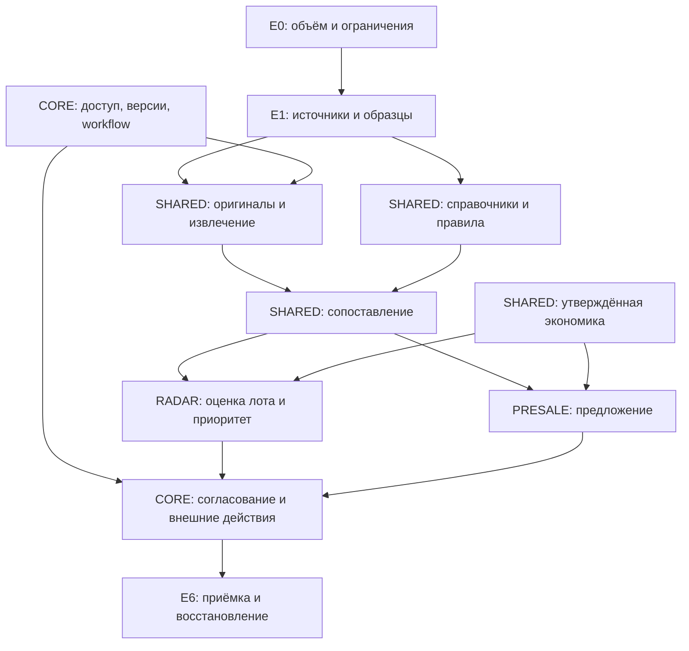

# Зависимости и границы реализации

Модули не должны импортировать внутреннюю бизнес-логику друг друга. Радар и пресейл зависят от SHARED и CORE; CORE не зависит от знания о крепеже. Адаптеры реализуют входные/выходные интерфейсы, но не определяют бизнес-правила.

Точные проверки и небольшие преобразования выполняются обычными функциями. Фоновая Activity объединяет достаточную для сохранения/повтора единицу работы; каждую строку CSV каталога не надо превращать в отдельное распределённое событие.

Идентификаторы функций относятся к плану версии 0.1. Изменение реализации возможно с сохранением смысла или явным описанием замены.

