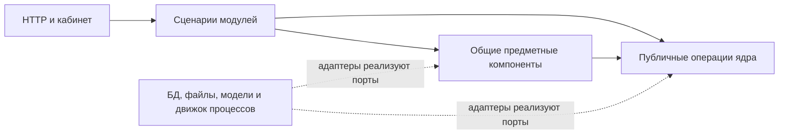

# Спецификация ядра BERVEL v0.1

Дата: 14 октября 2026. Статус: подготовлена для приёмки этапа 1 владельцем разработки. Контракт ядра: `0.1.0`.

Владелец разработки согласовал модульный монолит и гибридное стандартизированное хранилище. Эта спецификация определяет границы ядра, подключение модулей, сохранение данных и первый проверочный сценарий. Конкретный стек, движок процессов и правила промышленной эксплуатации выбираются отдельно; решения заказчика DEC-01–DEC-12 сохраняют свои статусы.

## 1 Цель и границы

Ядро обеспечивает общий доступ, регистрацию модулей, сохранение материалов и результатов, исполнение процессов, согласования и прослеживаемость. Новый модуль добавляет свою логику через публичные контракты, сохраняя читаемость существующих данных и историю процессов.

Стандартизация означает общие идентификаторы, происхождение, редакции, единицы, статусы качества и правила доступа. Поля спецификации, чертежа и складской выгрузки различаются и проверяются по своим схемам. Поддержка хранения нового вида материала не означает автоматическую поддержку его распознавания.

На этапе 1 создаются документы и искусственные примеры контрактов. В спецификацию ядра не входят производственные правила, каталог крепежа, формулы себестоимости, готовый радар или пресейл. Автоматическая подача, подпись, резервирование и проводки требуют отдельного объёма.

Основания: [обзор](00-overview.md), [исходное описание ядра](01-core.md), [данные](05-data-model.md), [контракты](06-contracts.md), [реальные источники](11-data-sources-and-intake.md). Глобальные ограничения архитектуры: `C:/Users/Evan/AI/ARCHITECTURE.md`.

## 2 Компоненты и зависимости

| Компонент | Владеет | Использует | Граница ответственности |
|---|---|---|---|
| Доступ | Политики разрешений и областей данных | Адаптер корпоративного входа | Проверяет пользователя и действие; роли из входного тела не считаются доверенными |
| Модули и конфигурация | Зарегистрированные версии модулей, схемы и редакции конфигурации | Проверенные пакеты при сборке приложения | Проверяет совместимость и зависимости; не загружает произвольный код пользователя |
| Хранилище материалов | `Artifact`, `ArtifactRevision`, технические связи с источниками | Адаптер хранения байтов | Сохраняет оригинал и редакцию; не интерпретирует содержимое |
| Хранилище результатов | `Dataset`, `DatasetRevision`, `DataRecord`, зависимости редакций | Реестр схем и доступ | Проверяет конверт и схему; предметный смысл принадлежит производителю данных |
| Процессы | Прикладная запись `ProcessRun`, ссылки на входы и результаты | Один выбранный движок исполнения | Хранит корреляцию и бизнес-состояние; движок отвечает за задачи, ожидания и восстановление исполнения |
| Проверка и согласование | `ReviewRequest`, `Approval`, причины отзыва | Редакции, доступ, политика действия | Одобряет точную редакцию для конкретного действия |
| Шлюз моделей | Политика провайдеров, квоты, метаданные вызова | Адаптер разрешённой модели | Проверяет разрешение обработки и форму ответа; предметную истинность проверяет прикладной компонент |
| Внешние действия и события | `ExternalAction`, outbox, дедупликация потребления | Адаптер действия и движок доставки | Сохраняет намерение, подтверждённый или неизвестный итог |
| Аудит | История решений и изменений состояния | Транзакция прикладной операции | Фиксируется вместе с решением; чувствительные тела не попадают в обычный журнал |

Общие прикладные компоненты владеют чтением документов, OCR, извлечением требований, импортом, каталогом, производственными правилами и экономикой. Бизнес-модули владеют жизненным циклом закупки, обращения или предложения. Адаптеры реализуют обмен и не определяют правила публикации справочника либо допустимость изделия.

Внутри компонента бизнес-правила не импортируют HTTP, ORM и SDK провайдера. Контракт необходимой внешней операции определяет потребляющий прикладной код. Конкретные реализации передаются явно при сборке приложения. Реестр модулей не является глобальным объектом поиска произвольных сервисов.

Доступ к соседнему компоненту проходит через его публичные операции или опубликованные события. Общая БД позволяет необходимую локальную транзакцию, но не разрешает прямую запись в чужие таблицы. Ограничения импортов и владения проверяются при реализации; выполнение в одном процессе само по себе не изолирует недоверенный код.

## 3 Контракт подключения модуля

Модуль — проверенный пакет кода с декларацией зависимостей и публичных возможностей. В v0.1 приложение собирается и выпускается совместно. Подключение может менять состав сборки, конфигурацию и принадлежащие модулю миграции; внутренние механизмы ядра для этого не переписываются. Выпуск без остановки не обещается до выбора схемы размещения.

### Манифест

| Поле | Тип и обязательность | Правило |
|---|---|---|
| `manifest_version` | Строка, обязательно | В v0.1 значение `0.1.0` |
| `module_id` | Строка, обязательно | Уникальное имя; используется как пространство имён |
| `module_version` | Строка `MAJOR.MINOR.PATCH`, обязательно | Версия пакета кода |
| `core_api_compatibility` | `{min_inclusive, max_exclusive}`, обязательно | Для примеров: `0.1.0` включённо и `0.2.0` исключительно |
| `dependencies` | Список `{module_id, min_inclusive, max_exclusive}`, обязательно | Пустой список допустим; циклы и отсутствующая обязательная зависимость блокируют включение |
| `permissions` | Список строк, обязательно | Объявляет необходимые действия; не выдаёт разрешения автоматически |
| `configuration_schema` | JSON Schema, обязательно | Конфигурация проверяется до публикации; секреты передаются ссылками |
| `workflow_types` | Список `{name, version}`, обязательно | Имя начинается с `module_id`; версия процесса отдельна от версии пакета |
| `data_types` | Список `{schema_id, schema_version, schema_path}`, обязательно | Относительные пути внутри проверенного пакета; владелец схемы — модуль |
| `event_types` | Список `{name, version}`, обязательно | Только опубликованные события; пустой список допустим |
| `owned_tables` | Список логических имён, обязательно | Описывает собственные предметные таблицы, если они нужны; таблицы ядра сюда не входят |

Списки обязательны, но могут быть пустыми. Регистрация схем, методов и процессов выполняется доверенной сборкой, а не текстом входящего документа. Публичные HTTP-маршруты и экраны подключаются кодом на внешней границе приложения; универсальный конструктор экранов или язык описания процессов не вводится.

Порядок подключения: проверить манифест → разрешить зависимости → проверить версии и схемы → проверить необходимые миграции → собрать обработчики с явными зависимостями → разрешить новые запуски. При ошибке приложение не включает несовместимый модуль частично.

Состояния модуля: `ENABLED`, `DRAINING`, `DISABLED`. `DRAINING` запрещает новые запуски и сохраняет обслуживание текущих. Переход в `DISABLED` допускается после завершения текущих процессов либо их явной отмены с историей. Отключение не удаляет данные, схемы и старые версии, необходимые для чтения.

### Публичные операции

Это прикладные контракты, а не уже реализованные HTTP-маршруты. `context` содержит проверенного действующего субъекта и область данных. Переданный вызывающим кодом идентификатор не заменяет проверку полномочий.

| Операция | Команда или запрос | Ответ и ограничение |
|---|---|---|
| `ArtifactService.register` | Финализированная загрузка, источник, роль, ID материала при новой редакции, `expected_revision`, ключ | `ArtifactRevisionRef`; байты сохранены и проверены до доступности ссылки |
| `ArtifactService.read` | Точная `ArtifactRevisionRef`, `context` | Разрешённые метаданные и ограниченный доступ к оригиналу |
| `DatasetService.publish` | Точная схема, записи, снимок входов, производитель, `expected_revision`, ключ | `DatasetRevisionRef`; редакция публикуется целиком и неизменяема |
| `DatasetService.read` | Точная редакция, курсор, `limit`, `context` | Страница записей из одной редакции; сервер ограничивает размер |
| `ProcessService.start` | Тип и версия процесса, точные входы, редакция конфигурации, ключ | `ProcessRunRef`; повтор возвращает тот же запуск |
| `ProcessService.cancel` | Запуск, ожидаемая версия состояния, причина | Состояние отмены; совершённые внешние действия остаются в истории |
| `ReviewService.request` | Редакция результата, действие, политика проверки | `ReviewRequestRef`; проверка имеет предмет и исполнителя |
| `ReviewService.decide` | Запрос, ожидаемая версия, решение, причина | `ApprovalRef` либо типизированный конфликт; права и актуальность проверены |
| `ExternalActionService.request` | Тип действия, точная редакция, адресат, одобрение при необходимости, ключ | `ExternalActionRef`; сохраняет намерение и не подменяет его подтверждением исполнения |
| `ModelGateway.invoke` | Цель, разрешённые входы, схема ответа, предел ресурсов, ключ вызова | Проверяемый ответ и метаданные использования; вызов не меняет бизнес-данные сам |

`ArtifactRevisionRef` = `{artifact_id, revision}`; `DatasetRevisionRef` = `{dataset_id, revision}`. Редакция — целое положительное число. `ProcessRunRef`, `ReviewRequestRef`, `ApprovalRef`, `ExternalActionRef` содержат устойчивый ID. Версия состояния изменяемого объекта отдельна от номера неизменяемой редакции.

Ключ повтора уникален в границах области данных, модуля и операции. Повтор с тем же ключом и другим содержанием отклоняется как `IDEMPOTENCY_CONFLICT`. Дедупликация файла по checksum не является правилом объединения закупок, клиентов или заказов.

При создании материала или набора `expected_revision=0`; при новой редакции передаётся номер предыдущей редакции. Публикация атомарно проверяет этот номер и создаёт следующий. Повтор той же загрузки в рамках того же материала не создаёт новую редакцию без изменения содержания или значимых исходных метаданных. Checksum вычисляется по сохранённым байтам, а не принимается на доверии от клиента.

Базовые ошибки: `VALIDATION_ERROR`, `FORBIDDEN`, `NOT_FOUND`, `UNSUPPORTED_SCHEMA`, `INCOMPATIBLE_MODULE`, `STALE_REVISION`, `IDEMPOTENCY_CONFLICT`, `TRANSIENT_DEPENDENCY_ERROR`, `QUOTA_EXCEEDED`, `EXTERNAL_RESULT_UNKNOWN`. Отсутствующие данные и ожидание эксперта — состояния процесса или результата. Проверка доступа выполняется до раскрытия наличия закрытого объекта; внешний ответ может объединять отсутствие и недоступность по политике доступа.

## 4 Стандартизированное гибридное хранилище

### Слои данных

| Слой | Содержание | Источник истины |
|---|---|---|
| Неизменяемые байты | PDF, XLSX, DOCX, изображение, чертёж, выгрузка, экспорт результата | Оригинал в хранилище объектов и его checksum |
| Общие метаданные | ID, редакции, происхождение, доступ, даты, роли, связь с обработкой | Структурированные записи ядра |
| Стандартизированные результаты | Записи с общим конвертом и типизированным `payload` по конкретной схеме | Неизменяемая опубликованная редакция набора |
| Предметные данные | Каталог, утверждённые правила, действующие остатки, бизнес-состояние закупки или предложения | Таблицы владеющего прикладного компонента или модуля |
| Производные представления | Поисковый индекс, витрина, кэш | Восстанавливаются из доступных исходных данных |

Базовый профиль реализации — PostgreSQL для метаданных, структурированных результатов и предметных таблиц; `JSONB` для типизированных изменяемых по форме результатов; объектное хранилище для байтов. Продукт, версия и библиотека доступа пока не выбраны. [PostgreSQL поддерживает совместное использование реляционных данных и JSON](https://www.postgresql.org/docs/current/datatype-json.html).

`JSONB` содержит результат обработки, а не единственную копию оригинала: он не сохраняет исходное форматирование и порядок ключей. Большие таблицы разбиваются на записи внутри набора. Файлы, изображения страниц и крупные технические представления передаются версионными ссылками, а не одним безразмерным JSON или телом события.

### Минимальные сущности ядра

| Сущность | Основные поля | Инвариант |
|---|---|---|
| `Artifact` | `artifact_id`, `owner_module_id`, область данных | Идентичность материала не определяется только хешем байтов |
| `ArtifactRevision` | `artifact_id`, `revision`, `object_ref`, `sha256`, тип, размер, источник, роль, время регистрации | Байты и техническое описание редакции неизменяемы; доступ и политика удаления управляются отдельно |
| `SchemaDefinition` | `schema_id`, `schema_version`, владелец, диалект, определение, checksum | Одна пара ID/версия имеет одно неизменяемое определение |
| `Dataset` | `dataset_id`, `owner_module_id`, область данных | Владелец определяет значение набора и публикацию его новой редакции |
| `DatasetRevision` | Редакция, тип данных, схема, производитель, запуск, входы, конфигурация, даты | Опубликованная редакция целостна и неизменяема |
| `DataRecord` | Редакция набора, `record_id`, состояние качества, `payload`, источники, замечания | Запись принадлежит одной редакции и проверяется её схемой |
| `InputSnapshot` | Точные ссылки на использованные редакции и их роли | Повторное чтение по снимку не переключается на текущую редакцию источника |
| `RevisionDependency` | Зависимая редакция, редакция основания, причина зависимости | Изменение основания позволяет найти затронутые результаты |

Для всех чтений и изменений проверяется область данных. Результат не расширяет доступ к своим источникам: его эффективный доступ учитывает ограничения входов. В первом сценарии все входы одного набора находятся в одной области; объединение разных областей требует отдельной явной политики. Совпадение байтов не раскрывает чужие ссылки или метаданные.

Происхождение материала содержит `origin_system`, `external_id` и `external_revision`, если они известны; идентификаторы источника сохраняются строками. Для загрузки файла дополнительно сохраняются исходное имя, формат и дата получения. Отсутствие внешнего ID не заменяется вымышленным номером. Роль файла и контекст конкретного дела хранятся в связи с использованием редакции: один оригинал может участвовать в нескольких делах без объединения их прав и жизненных циклов.

Ссылка на источник содержит точную `ArtifactRevisionRef`, роль и локатор. Поддерживаемые формы локатора: страница/область PDF или изображения, лист/строка/колонка таблицы, раздел/абзац документа, строка/колонка CSV. Координаты появляются при извлечении; их не требуется заранее получать от заказчика. Источник вывода может быть другой точной редакцией набора, ведущей к оригиналу.

### Конверт результата

Обязательные поля опубликованного набора:

| Поле | Смысл |
|---|---|
| `envelope_version` | Версия общего конверта; здесь `0.1.0` |
| `dataset_id`, `revision` | Идентичность и точная редакция набора |
| `data_type`, `schema_version` | ID и версия схемы предметного `payload` |
| `owner_module_id`, `data_scope` | Владелец и область данных; определяются сервером |
| `producer` | `{module_id, module_version, workflow_type, workflow_version}` |
| `process_run_id`, `input_snapshot_id`, `configuration_revision` | Прослеживаемость конкретного запуска |
| `created_at`, `observed_at` | Время сохранения в UTC и время применимости источника либо `null` |
| `quality_state` | `COMPLETE`, `PARTIAL` или `CONFLICTED`; не является допуском производства |
| `records` | Страницы записей либо записи в экспортном примере; хранение и API поддерживают пагинацию |

Запись содержит `record_id`, `quality_state`, `payload`, `evidence_refs`, `issues`. ID записи стабилен между редакциями, если источник позволяет надёжно установить ту же строку; при отсутствии правила связь остаётся неизвестной. Замечание содержит код, путь к полю и объяснение. Неизвестные версии не интерпретируются как текущие.

Общие правила значений:

- Значимые десятичные значения на границе JSON передаются строками; предметные таблицы используют точное десятичное представление. Единица обязательна для известной величины. Float и неявная конверсия штук в массу не применяются.
- Неизвестное значение имеет `state=UNKNOWN` и `value=null`, причину и связь с источником. Ноль — известное значение. Конфликт сохраняет ссылки на противоречащие сведения и замечание; выбор одного значения не маскируется под нормализацию.
- Исходное значение и исходная единица сохраняются рядом с нормализованной величиной или в её доказательстве. Код единицы и правило преобразования определяет владелец схемы.
- Время применимости источника не подменяется временем загрузки. Если зона исходного дедлайна неизвестна, она остаётся неизвестной. Успешный повтор загрузки не делает старый остаток свежим.
- Проверка структуры не означает экспертного подтверждения. Доверие к источнику и предметное согласование фиксируются отдельно. Роли `original_request`, `third_party_assessment` и `test_fixture` не взаимозаменяемы.

Реестр схем использует JSON Schema Draft 2020-12 для формы данных и отдельные предметные проверки для смысла. Проверка форматов дат должна быть явно включена в выбранном валидаторе; одна аннотация `format` не считается достаточной. [Стандарт JSON Schema Validation](https://json-schema.org/draft/2020-12/json-schema-validation).

Если строки набора относятся к разным моментам наблюдения, время сохраняется в каждой строке по её схеме, а `observed_at` набора равно `null`. Вычисление общей даты или возраста не скрывает различие строк.

Общий тип величины описан в [core-common.schema.json](../contracts/core-v0.1/core-common.schema.json). Его `KNOWN`/`UNKNOWN` относится к наличию нормализованного значения; противоречие между источниками фиксируется качеством записи и замечанием. Схемы используют зарегистрированные `$id` и локально разрешаемые `$ref`; валидатор не скачивает произвольные схемы из сети. В учебных схемах спецификация измеряется в `piece`, складская строка — в `kg`; это ограничения примеров, а не полный перечень единиц платформы.

### Сохранение и публикация

1. Приём проверяет полномочия, фактический формат и ограничения. Оригинал сохраняется; неполная загрузка не становится доступной редакцией.
2. Прикладной обработчик выбирает подходящий способ чтения. Неподдерживаемый формат сохраняет оригинал и явную причину отсутствия обработки.
3. Обработчик формирует записи по зарегистрированной схеме, ссылки на источник и замечания. Ошибку извлечения можно сохранить как неполный результат; невалидный контракт нельзя объявить опубликованным набором.
4. Записи сначала сохраняются в недоступной для обычного чтения подготовке. Публикация проверяет полноту загрузки записей, схему и права, затем атомарно делает редакцию доступной вместе с аудитом и нужным событием outbox. Частичный технический импорт не становится полной редакцией случайно.
5. Предметный компонент отдельно решает, можно ли опубликовать данные в действующий каталог или остатки. Набор извлечённых фактов остаётся исходным снимком. Если предметная таблица — лишь ускоренное представление этого снимка, она объявляется производной и восстанавливаемой; двух независимо редактируемых источников истины не создаётся.

БД и хранилище файлов не являются одной транзакцией. Сначала подтверждается сохранение объекта, затем фиксируется доступная ссылка в БД. Сбой после сохранения байтов оставляет объект для сверки; обратный порядок не создаёт доступную запись с отсутствующими байтами. Удаление временных и бесхозных объектов следует утверждённой политике.

Неизменяемость редакции не означает бессрочного хранения. Удаление оригиналов, результатов, индексов и копий требует согласованной политики R06/DEC-09; при удалении основания сохранённый вывод не показывает доступную ссылку на несуществующий оригинал. Периоды хранения и автоматическое удаление на этапе спецификации не назначаются.

### Владение предметными данными

| Данные | Владелец смысла и изменений |
|---|---|
| Извлечённый текст, страницы, внешние требования | Общий компонент документов и извлечения |
| Пакет импорта и соответствие полей источника | Прикладной компонент импорта; адаптер только доставляет данные |
| Каталог и производственные ограничения | Соответствующие общие предметные компоненты |
| Утверждённый складской снимок | Компонент склада при его включении; внешний файл сам по себе не даёт утверждения |
| Закупки, лоты, рекомендация и решение участвовать | Тендерный радар |
| Обращения, предложение и коммерческий жизненный цикл | Пресейл |
| Технические редакции, сохранение набора, аудит | Ядро |

Производитель владеет схемой и смыслом результата; ядро владеет механизмом его хранения. Потребитель выбирает явно поддерживаемые схемы и обращается по публичному контракту. Общее хранилище не превращает ядро в владельца всех бизнес-понятий.

## 5 Расширение и совместимость

Новый тип результата добавляется регистрацией новой схемы в пространстве имён владельца и нового обработчика модуля. Базовые таблицы хранения результатов, конверт и внутренние операции ядра при этом сохраняются. Примеры расширения: строка спецификации, измерение чертежа, строка складской выгрузки. Их значения различаются, но происхождение, редакции и доступ единообразны.

Новая предметная сущность или измеримая потребность в индексах может потребовать таблицы и миграции владельца. Это плановое расширение; обещание добавлять любые бизнес-модели без миграций не даётся. Формат извлечения, публичная схема обмена и физическая схема БД имеют отдельные версии.

| Изменение | Действие |
|---|---|
| Новый вид данных | Новый `schema_id`; старые читатели продолжают работу со своими схемами |
| Новое необязательное поле | Новая версия схемы; совместимость подтверждается тестом читателя, а не предполагается |
| Изменение единицы, смысла или обязательности | Несовместимая версия; явное преобразование либо новый читатель |
| Обновление общего API `0.1.x` | Исправление с сохранением контракта; несовместимое изменение требует нового диапазона, начиная с `0.2.0` |
| Пересчёт старого результата | Новая редакция с новыми версиями обработки; исходная редакция остаётся доступной по политике хранения |
| Новая предметная таблица | Миграция владельца, проверка старых процессов и стратегия выпуска |

Потребитель объявляет поддерживаемые пары схемы и версии. Старую схему нельзя переписать под тем же номером. JSON Schema проверяет конкретную редакцию; различие версий не компенсируется молчаливым удалением неизвестных полей. Изменение формата хранения не является автоматическим обновлением бизнес-знаний.

Бесшовность в v0.1 означает сохранение старых ID, редакций, схем, публичных контрактов и активных процессов при поддерживаемом обновлении. Она проверяется подключением второго учебного модуля и совместным чтением старых и новых данных. Самостоятельный выпуск произвольных сторонних плагинов и универсальная EAV-модель «поле — значение» для всех бизнес-данных не требуются.

## 6 Процессы согласования и согласованность

`ProcessRun` фиксирует тип и версию процесса, модуль, точные входы и конфигурацию. Состояния исполнения: `QUEUED`, `RUNNING`, `WAITING_DATA`, `WAITING_REVIEW`, `READY`, `COMPLETED`, `FAILED`, `CANCELLED`. Бизнес-решение модуля хранится отдельно. История выбранного движка описывает исполнение, а прикладная БД хранит бизнес-решения и результаты; они связаны устойчивыми ID и сверкой.

Запись запуска и намерение передать его движку фиксируются одной транзакцией. Потеря подтверждения запуска не создаёт новый процесс. Повтор сохранения шага не публикует вторую редакцию; поздний обработчик проверяется по актуальной версии состояния. Механизмы очереди и ожидания реализует выбранный движок, а не второй собственный оркестратор.

Одобрение связано с точной редакцией результата, действием и политикой. Изменение результата не переносит одобрение на новую редакцию. Новая версия источника помечает зависимые результаты устаревшими; до решения о влиянии использование прежнего одобрения для зависимого действия блокируется. Разрешение сохранить прежнее решение оформляется уполномоченным сотрудником с основанием. Правила возраста данных задаёт владелец источника; при отсутствии правила положительный допуск к действию, требующему свежести, не предполагается.

Команда согласования передаёт ожидаемую редакцию и версию состояния. Конфликт не перезаписывает чужое решение. Частичная обработка может быть принята сотрудником только для предусмотренного политикой действия; это не разрешение обещать производство или срок.

Внешнее действие сохраняет точное намерение, адресата, ссылки на согласованные артефакты, ключ и результат. Перед исполнением заново проверяются полномочия, актуальность и политика. Проверка привязывает исполнение к конкретной редакции; изменение исходных данных после этой точки фиксируется отдельно и не отменяет уже совершённый эффект. Неизвестный итог требует сверки, а не общего автоматического повтора. Одобрение и команда отправки — разные операции.

Событие содержит `event_id`, тип и версию, точный объект и редакцию, время, producer, область данных, correlation и causation, небольшой payload или ссылку. Outbox фиксируется в транзакции с соответствующим изменением. Потребитель защищён от повторов по ID события; порядок разных потоков не предполагается. Аудит и события не являются полным event sourcing состояния.

## 7 Первый проверочный сценарий

Сценарий [CORE-V01](../quality/core-v0.1-scenario.md): загрузка искусственной спецификации → сохранение оригинала → обработка учебным модулем → публикация стандартного набора → проверка сотрудником → новая редакция → подключение учебного импорта склада без изменения внутренней реализации ядра.

Сценарий проверяет работу контрактов и хранения; он не доказывает качество OCR, возможности завода или точность модели. Примеры находятся в [core-v0.1-examples.json](../quality/core-v0.1-examples.json), схемы предметных payload — в [requirement-row](../contracts/core-v0.1/demo.requirement-row.schema.json) и [stock-row](../contracts/core-v0.1/demo.stock-row.schema.json).

Критерии: оригиналы восстановимы по checksum; результаты читаются по точной редакции; пропуск количества остаётся неизвестным; одобрение не переносится; дубли и падение обработчика не дублируют публикацию; права соблюдаются; складской формат добавляется новой схемой без изменения общих таблиц; старый набор остаётся читаемым.

## 8 Приёмка спецификации и последующие решения

Этап 1 готов к приёмке, когда границы, владельцы, контракт модуля, правила хранения и сценарий согласованы между собой; искусственные примеры соответствуют описанным полям; ссылки и исходные материалы целостны. Статус будущих проверок приложения остаётся `not_run` до реализации.

До следующего этапа требуется приёмка этой редакции. Следующий предложенный этап — эксперимент с одним движком процессов по перезапуску, ожиданию человека, повторной доставке и смене версии. Выбор n8n/Temporal остаётся DEC-02. Стек, корпоративный вход, ограничения файлов и нагрузки, сроки хранения, размещение, RPO/RTO, модели и клиентские правила уточняются в соответствующих этапах по [открытым решениям](09-open-decisions.md).

Полный каталог, промышленная 1С и разрешение передачи реальных документов модели не нужны для искусственного технического сценария. Их отсутствие не превращается в подтверждение производственных или коммерческих данных.
